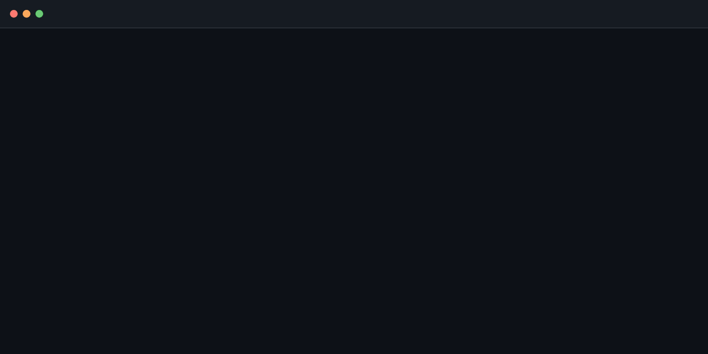
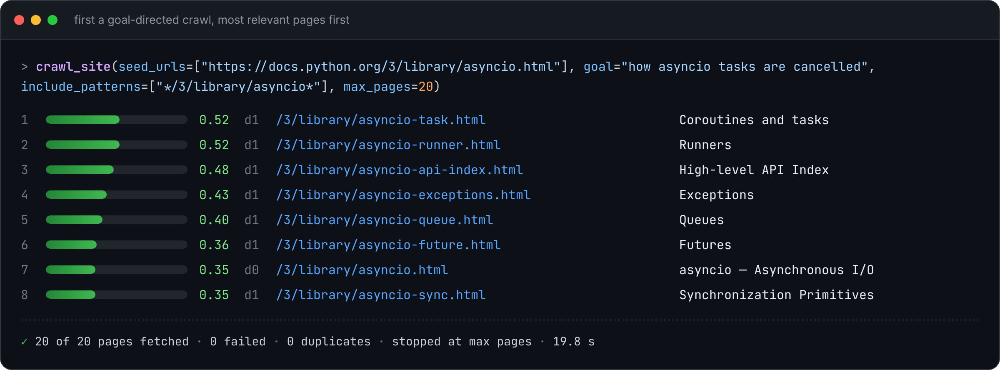
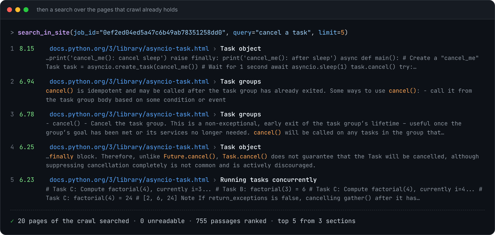
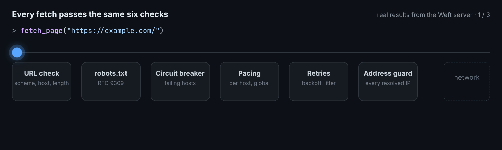
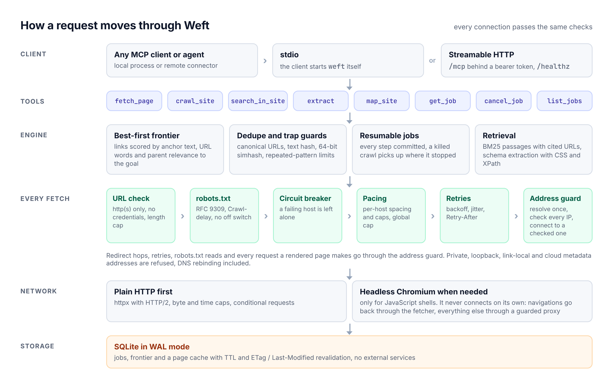

<h1 align="center">Weft</h1>

<p align="center">
  <b>A web crawler that AI agents call as a tool. Give it a site and a goal; it crawls toward the goal and answers with passages and structured data, each with the URL it came from.</b><br>
  It obeys robots.txt, paces itself per host and refuses to reach private networks or cloud metadata, whoever asks.
</p>

<p align="center">
  <a href="#a-live-session">Live session</a> ·
  <a href="#getting-started">Get started</a> ·
  <a href="#how-it-works">How it works</a> ·
  <a href="#safety">Safety</a> ·
  <a href="#architecture">Architecture</a> ·
  <a href="#design-decisions">Design decisions</a> ·
  <a href="#limitations">Limitations</a> ·
  <a href="#roadmap">Roadmap</a>
</p>

<p align="center">
  <a href="https://github.com/TheMEGALODON55681/weft/actions/workflows/ci.yml"></a>
  
  
  
  
  
  
  
  <a href="LICENSE"></a>
</p>

---

<p align="center">
  
</p>
<p align="center"><em>One session, replayed from the real tool output with the timing compressed: a crawl toward a goal, a search over what it found, and three requests Weft refuses.</em></p>

## At a glance

| | |
|---|---|
| **What it is** | An MCP server with eight tools: `fetch_page`, `crawl_site`, `search_in_site`, `extract`, `map_site`, `get_job`, `cancel_job` and `list_jobs` |
| **Transports** | stdio for a local client, and streamable HTTP at `/mcp` behind a bearer token, with `/healthz` |
| **Crawling** | Best-first toward a goal in plain words. Exact and near-duplicate pages, canonical aliases and crawler traps are skipped |
| **Answers** | Passages ranked with BM25 and cut at sentence and block ends, at most two per section. JSON that validates against your schema, from CSS and XPath selectors |
| **Safety** | Every connection passes one address check: redirects, retries, robots.txt reads and a rendered page's own requests. robots.txt has no off switch |
| **Rendering** | Plain HTTP first. Headless Chromium only for pages that need JavaScript, and it never connects on its own |
| **State** | One SQLite file in WAL mode: jobs, frontier and a page cache with ETag and Last-Modified revalidation. A killed crawl resumes |
| **Code** | 5,465 lines of Python in `src/`, 9,213 in `tests/`, strict mypy, ruff |
| **Tests** | 912, all against a local fixture site, plus fuzzing and hand-made mutants for every phase from the second on |
| **CI** | Three jobs on Linux for every push: lint and types, the suite with real Chromium, and the Docker image with the suite run inside it |

## Overview

An agent that browses the web needs more than a page fetcher. It needs to find the right pages on a site without reading all of them, to quote what it found with a link it can cite, and to stay polite to the sites it visits. It also needs a guard, because the agent will follow URLs it found on pages written by strangers, and one of them will point at `169.254.169.254`.

Weft does those four things behind one MCP connection. Tell it where to start and what you are looking for. It crawls the most promising links first, keeps a resumable job in SQLite, and hands back ranked passages or schema-checked JSON, each tied to the URL it came from. Every request it makes, including the ones a JavaScript page makes on its own, passes the same robots, pacing and address checks.

## A live session

Each image below is a capture of real output from the Weft server on 23 November 2026, attached to an MCP client.

**1. Crawl toward a goal.** Links whose anchor text, URL or parent page match the goal go first, which is how the task page came out on top.

<p align="center"></p>

**2. Search the pages that crawl holds.** No new crawl starts. Passages end at sentence and block boundaries, and no section takes more than two places.

<p align="center"></p>

**3. Pull structured data.** Selectors live inside a JSON Schema, and the result is checked against it. No model is involved.

<p align="center"></p>

## How it works

1. **Connect.** A client starts `weft` over stdio, or reaches `/mcp` over streamable HTTP with a bearer token. Bound beyond loopback, the HTTP server refuses to start without one.
2. **Check the URL.** http and https only, a host, no credentials in the URL, a length cap. A bad one fails with `invalid_url` before any network work.
3. **Pass the gates.** robots.txt for the origin is read and cached under RFC 9309 rules, the host's circuit breaker is consulted, the request waits its turn under per-host and global caps, and transient failures retry with backoff, jitter and `Retry-After`.
4. **Connect to a checked address.** The host name is resolved once, every address in the answer is checked, and the socket goes to one that passed. Redirects are followed by hand, one hop at a time, and every hop goes back through steps 2 to 4.
5. **Read the page.** Bytes are decoded even when the charset lies, documents that nest too deep are cut before parsing, and the main content becomes Markdown with its title, metadata and links.
6. **Render only if needed.** A page with a script and too little text gets a headless Chromium render. The browser renders the body Weft already fetched, its navigations come back through the fetcher, and every other request goes through a proxy that applies the same address check.
7. **Crawl.** New links are canonicalised, scored against the goal and queued best first in SQLite. Near duplicates (64-bit simhash), canonical aliases and repeating URL patterns are dropped. Every step is committed, so a killed job picks up where it stopped.
8. **Answer.** `search_in_site` cuts the pages into passages, ranks them with BM25 and keeps at most two per section. `extract` runs your selectors and validates the result against your schema. Every answer carries the URL it came from.

## Safety

<p align="center"></p>
<p align="center"><em>The six checks, animated from three real calls. The metadata address trips the guard on its very first connection, the robots.txt read.</em></p>

An agent picks up URLs from pages anyone can write, so Weft treats every URL as hostile. The address guard sits under the HTTP client's connect step, which is the only place that sees the final address of every connection: a redirect to `localhost`, a DNS answer that changes between two lookups and a script in a rendered page all meet it there. Private, loopback, link-local, carrier-grade NAT, multicast and cloud metadata ranges are refused, along with the IPv6 forms that wrap them.

<p align="center"></p>

Politeness has no off switch either. robots.txt is obeyed on every hop with `Crawl-delay`, requests to one host are spaced and capped, and a failing host is left alone by a circuit breaker. Stealth scraping, CAPTCHA solving and fingerprint evasion are out of scope. The [safety rules in full](docs/Reference.md#safety-and-politeness) list every range and limit.

## Architecture

<picture>
  <source media="(prefers-color-scheme: dark)" srcset="docs/assets/architecture-dark.png">
  
</picture>

```text
src/weft/
  server/        the MCP server: tool definitions, stdio and HTTP transports, the bearer token check
  fetch/         http.py (the redirect loop and the order of the gates), ssrf.py (the address guard),
                 robots.py, limits.py (spacing, caps, circuit breaker), retry.py,
                 proxy.py and browser.py (Chromium behind the guard), page.py, cache.py
  extract/       decode.py, content.py (HTML to Markdown), links.py, nesting.py (the depth cap),
                 schema.py (selectors in a JSON Schema), llm.py (the optional model fallback)
  frontier/      canon.py (canonical URLs and URL patterns), dedupe.py (hash and simhash),
                 score.py (link scores against the goal), store.py (the SQLite frontier), sitemap.py
  rank/          bm25.py, passages.py (blocks, sentence cuts, the per-section limit), rerank.py
  jobs/          crawl.py (workers, trap limits, the time budget), manager.py (start, cancel, resume)
  retrieval.py   search and extraction over a job's pages
  config.py      typed settings from the environment, a TOML file and defaults
  db.py          SQLite in WAL mode, migrations, one database thread
tests/           912 tests, a local fixture site, an HTTP/2 server over TLS, fuzz properties
docs/            Reference, Architecture, Phases and the build log
Dockerfile       three stages: base, test and runtime, which runs as an unprivileged user
.github/workflows/ci.yml   lint and types, the suite on Linux, the image with the suite inside it
```

[docs/Architecture.md](docs/Architecture.md) has the data flow of every tool, the storage schema, the error model and the security posture.

## Tech stack

| Layer | Choices |
|---|---|
| Server | Python 3.12, FastMCP 4.2.4 on the MCP SDK 2.3.0, uvicorn 0.54.0, Starlette 1.10.0 |
| Fetching | httpx 0.28.1 with HTTP/2 (h2 4.4.1), httpcore 1.0.9 under the address guard |
| Rendering | Playwright 1.65.2 driving `chromium-headless-shell` |
| Extraction | trafilatura 2.3.1, selectolax 1.0.2, lxml 6.1.3 with cssselect 1.6.0, jsonschema 4.26.0, charset-normalizer 3.5.2 |
| Ranking | BM25, simhash and the passage splitter, written for this project |
| Settings | pydantic 2.14.4, pydantic-settings 2.16.3 |
| Storage | SQLite from the standard library, in WAL mode |
| Tests | pytest 9.2.0, pytest-asyncio 1.5.0, hypothesis 6.170.17, ruff 0.17.6, mypy 2.4.1 (strict) |
| Delivery | uv 0.11.23 with a lockfile, Docker on `python:3.12-slim-bookworm`, GitHub Actions |

## Getting started

Weft needs Python 3.12 or newer.

1. Install it.

   ```bash
   git clone https://github.com/TheMEGALODON55681/weft.git
   cd weft
   python -m venv .venv
   .venv/bin/pip install -e .                              # Windows: .venv\Scripts\pip install -e .
   .venv/bin/playwright install chromium-headless-shell    # optional, about 290 MB, for JavaScript pages
   ```

2. Add it to any MCP client that starts stdio servers, with the absolute path to the executable. On Windows that is `C:\\path\\to\\weft\\.venv\\Scripts\\weft.exe`.

   ```json
   {
     "mcpServers": {
       "weft": {
         "command": "/absolute/path/to/weft/.venv/bin/weft",
         "env": { "WEFT_CONTACT": "you@example.org" }
       }
     }
   }
   ```

   `WEFT_CONTACT` goes into the User-Agent, so site operators can reach you. Restart the client and the eight tools appear.

3. To serve it remotely, run the image behind a TLS reverse proxy. It refuses to start without `WEFT_AUTH_TOKEN`.

   ```bash
   docker build -t weft .
   docker run --rm --init -p 8000:8000 \
     -e WEFT_AUTH_TOKEN -e WEFT_CONTACT \
     -v weft-data:/data \
     --memory 2g --pids-limit 512 \
     --cap-drop ALL --security-opt no-new-privileges \
     weft
   ```

4. Run the checks.

   ```bash
   uv sync --frozen --extra dev
   uv run ruff check . && uv run ruff format --check . && uv run mypy && uv run pytest
   ```

[docs/Reference.md](docs/Reference.md) has every tool argument and result field, the error codes, all settings, the remote client steps and the development notes.

## Design decisions

**Why check the address at connect time instead of checking the URL?** A host name can resolve to a public address when it is checked and to `127.0.0.1` when it is used, and a public page can redirect anywhere. Weft resolves the name once, checks every address in the answer and connects to an address it checked, inside the HTTP client's connect step. Redirects are followed by hand so each hop is checked too. See the security posture in `docs/Architecture.md`.

**Why put Chromium behind a proxy instead of letting it fetch?** Chromium does its own DNS and opens its own connections, so a guard under the HTTP client never sees them. Weft hands the browser the body it already fetched, sends each navigation back through the fetcher, launches Chromium with no name resolution of its own and no loopback bypass, and routes everything else through a local proxy that connects through the same guard. A test serves an allowed page that loads images, stylesheets, fetches, sockets, workers and frames from blocked hosts and counts every connection.

**Why its own robots.txt parser?** The standard library's matches rules in file order rather than by length and has no `*` or `$`. Weft's parser follows RFC 9309, and its matcher is a plain string search instead of a regular expression, because the site writes the file and a chain of wildcards can make a regex backtrack for a very long time.

**Why BM25 by default instead of embeddings?** It needs no model, no network and no GPU, gives the same answer every time, and is the same BM25 the crawl uses to score pages, so the crawl and the search agree on what relevant means. Embedding rerank is there behind a flag, and it reorders the keyword hits rather than replacing them.

**Why SQLite instead of a queue and a database server?** Weft should run from one command with nothing else to start. SQLite in WAL mode holds the jobs, the frontier and the page cache, and every crawl step is committed, which is what lets a killed crawl resume.

**Why its own bearer token check?** The stock verifier does not compare in constant time. Weft hashes both sides with SHA-256 and compares the digests with `hmac.compare_digest`, so a wrong token leaks neither how much of it matched nor its length.

**Why property-based tests with a fixed seed?** hypothesis shrinks a failure to the smallest input that causes it, a three-character URL instead of a 400-character one. The default run draws the same 1,000 examples every time, so a red build means the code changed, and `WEFT_FUZZ_EXAMPLES` asks for a deeper random run.

## Limitations

1. **HTML only.** PDFs, JSON and images come back as `unsupported_content_type`.
2. **No logins.** Weft sends no cookies, so pages behind a sign-in are out of reach.
3. **Per-process limits.** Pacing is per host name and per server. Two Weft servers do not share limits, and two names for one server are not merged.
4. **One token, no identity.** Every token holder shares the cache and the jobs, and there is no cap on queued jobs.
5. **English text handling.** Stemming and stop words are English only. Chinese, Japanese and Thai are not segmented.
6. **Nothing is deleted.** Jobs and cached pages stay, at about 5 KB of database per crawled page.
7. **Extraction threads cannot be stopped.** A page or a selector written to stall the parser holds one of four extraction threads until it finishes. The depth cap closes the known quadratic case.

The [full list](docs/Reference.md#limits) has the rest, with numbers.

## Roadmap

**Done**

- [x] `fetch_page` over stdio, typed settings, JSON logging, SQLite with migrations (Phase 1)
- [x] The address guard, robots.txt, pacing, retries and the circuit breaker (Phase 2)
- [x] Headless rendering behind a guarded proxy (Phase 3)
- [x] Goal-directed crawling, resumable jobs, sitemaps and the page cache (Phase 4)
- [x] Passage search, schema extraction and optional model providers (Phase 5)
- [x] Streamable HTTP with a bearer token, Docker and `/healthz` (Phase 6)
- [x] Fuzzing, an HTTP/2 test, a load test and CI on Linux (Phase 7)
- [x] Whole-sentence passages, search by job id and varied top hits (Phase 8)

**Near term**

- [ ] A retention setting for jobs, frontier rows and cached pages
- [ ] Extraction in a child process that can be killed
- [ ] Per-client tokens, expiry and a cap on queued jobs
- [ ] Honour `Cache-Control: no-store`, and read sitemaps with namespace prefixes

**Later**

- [ ] Find why crawl throughput falls from 43 to 32 pages a second between 400 and 5,000 pages, and bucket the simhash comparison
- [ ] A local embedding provider behind the same interface as the HTTP one
- [ ] Authenticated crawls with cookies passed per job and a page cache kept apart for them
- [ ] Start Chromium inside the hardened runtime container in CI

## Acknowledgements

- **[RFC 9309](https://www.rfc-editor.org/rfc/rfc9309)**, the Robots Exclusion Protocol, which the robots.txt parser follows.
- **Libraries:** FastMCP and the MCP Python SDK, httpx, Playwright, trafilatura, selectolax, lxml, jsonschema, pydantic, uvicorn, hypothesis.
- **The Python documentation**, which the live session above crawled. Its text belongs to the Python Software Foundation.

## License

MIT. See [LICENSE](LICENSE).

<p align="center">
  Built by <a href="https://github.com/TheMEGALODON55681">Aryan Sharma</a> · 2026<br>
  <a href="https://www.linkedin.com/in/aryan-sharma-19906441b/">LinkedIn</a>
</p>
