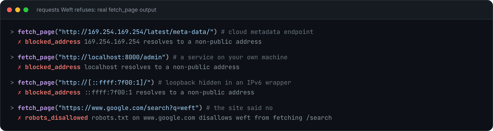
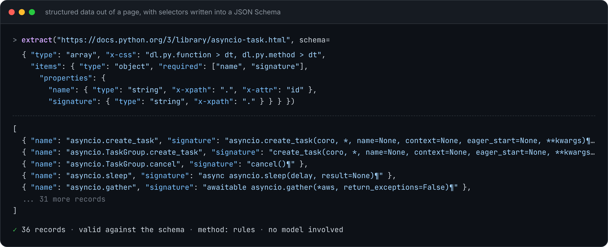

# Weft

[](https://github.com/TheMEGALODON55681/weft/actions/workflows/ci.yml)


**A web crawler that AI agents call as a tool.** Weft runs as an MCP server. An agent gives it a site and a goal in plain words, and Weft crawls toward that goal, ranks what it found, and returns passages and structured data with the URL each one came from, so the agent can cite its sources.

It obeys robots.txt, paces itself per host, and refuses to be pointed at private networks or cloud metadata endpoints, including through redirects, DNS tricks and the requests a rendered page makes on its own. It needs no external services: state lives in one SQLite file.

## A live run

Weft attached to an MCP client, asked about task cancellation in the Python docs. Every value below is real output from that run on 23 November 2026.


The crawl is best-first: links whose anchor text, URL or parent page match the goal are fetched before the rest, which is how the task page came out on top in this run. The search then reads the pages that crawl already holds, cuts them into passages at sentence and block boundaries, ranks them with BM25, and keeps at most two hits from any one section.

## Why Weft

- **It follows a goal.** A frontier scored against the goal decides what to fetch next. It skips exact and near-duplicate pages (text hash and 64-bit simhash), canonical aliases and crawler traps such as endless calendars.
- **It answers with sources.** `search_in_site` returns passages with the page URL, title and heading. `extract` returns JSON that validates against a schema you write, with CSS or XPath selectors inside it.
- **It is safe to point at the open web.** Every connection passes the same address check, and robots.txt has no off switch. Stealth scraping, CAPTCHA solving and fingerprint evasion are out of scope on purpose.
- **It survives restarts.** Every step of a crawl is committed to SQLite, so a killed crawl resumes where it stopped. Pages are cached with ETag and Last-Modified revalidation.
- **It renders only when it has to.** Pages are fetched over plain HTTP first. By default, headless Chromium starts only for a page that has a script and too little text without it, and the browser never reaches the network on its own.

## What it refuses



An agent can pick up a URL from a hostile page, so Weft treats every URL as untrusted. It resolves the host name itself, checks every address in the answer, and connects only to an address it checked. Redirect hops, retries, robots.txt reads and the requests a rendered page makes all go through the same check. The [safety section of the reference](docs/Reference.md#safety-and-politeness) lists the ranges and the rules.

## Structured data out of a page



Write the selectors into a JSON Schema and Weft returns data that validates against it, from one page or from every page of a crawl. A language model can fill in when the selectors find too little, but that is off by default and needs an endpoint you configure.

## How it works

<picture>
  <source media="(prefers-color-scheme: dark)" srcset="docs/assets/architecture-dark.png">
  
</picture>

[docs/Architecture.md](docs/Architecture.md) covers each module, the data flow of every tool, the storage schema and the error model.

## Quick start

Weft needs Python 3.12 or newer.

```bash
git clone https://github.com/TheMEGALODON55681/weft.git
cd weft
python -m venv .venv
.venv/bin/pip install -e .                              # Windows: .venv\Scripts\pip install -e .
.venv/bin/playwright install chromium-headless-shell    # optional, about 290 MB, for JavaScript pages
```

Then add Weft to any MCP client that starts stdio servers. Use the absolute path to the executable:

```json
{
  "mcpServers": {
    "weft": {
      "command": "/absolute/path/to/weft/.venv/bin/weft",
      "env": { "WEFT_CONTACT": "you@example.org" }
    }
  }
}
```

On Windows the command is `C:\\path\\to\\weft\\.venv\\Scripts\\weft.exe`. `WEFT_CONTACT` goes into the User-Agent, so site operators can reach you. Restart the client and the eight tools appear.

**Remote.** `weft --transport http` serves MCP over streamable HTTP at `/mcp`, behind a bearer token, with `/healthz` for health checks. Bound beyond loopback, it refuses to start without a token. The Docker image runs it as an unprivileged user:

```bash
docker build -t weft .
docker run --rm --init -p 8000:8000 \
  -e WEFT_AUTH_TOKEN -e WEFT_CONTACT \
  -v weft-data:/data \
  --memory 2g --pids-limit 512 \
  --cap-drop ALL --security-opt no-new-privileges \
  weft
```

Put a TLS reverse proxy in front of it. [Run remotely](docs/Reference.md#run-remotely) has the token, proxy and client steps.

## Tools

| Tool | What it does |
| --- | --- |
| `fetch_page` | One page as clean Markdown, with title, metadata, links, status and the final URL after redirects. |
| `crawl_site` | A goal-directed crawl as a background job, returning the most relevant pages so far. |
| `search_in_site` | The passages that best answer a query, from a new crawl or from the pages of an existing one. |
| `extract` | JSON that validates against your schema, from a page or from every page of a crawl. |
| `map_site` | A site's URLs from its sitemaps and the start page's links, without crawling. |
| `get_job` | A job's status, metrics and pages, most relevant first. |
| `cancel_job` | Stops a queued or running job. Its pages stay readable. |
| `list_jobs` | Recent jobs, newest first. |

Every argument, result field and error code is in [docs/Reference.md](docs/Reference.md#tools).

## How it is tested

| Check | What it covers |
| --- | --- |
| 912 tests | Run against a local fixture site that never touches the internet, with redirect loops, crawler traps, near-duplicate pages, a JavaScript shell, robots.txt rules and an HTTP/2 server over TLS. |
| Address guard tests | Private and metadata ranges refused directly, through redirects, through DNS rebinding and from inside a rendered page. |
| Mutation checks | From the second phase on, each phase ends with hand-made mutants of its new code. A mutant that survives either gets a test that kills it or is shown to change nothing. |
| Fuzzing | URL canonicalisation, HTML, robots.txt, sitemaps and passage splitting, with hypothesis. |
| Static checks | ruff, and mypy in strict mode. |
| CI | Three jobs on Linux for every push: lint and types, the full suite with real Chromium, and the Docker image, built, run through the suite and checked for the token refusal, `/healthz` and a clean stop. |

The [build log](docs/BuildLog.md) records each phase's decisions, the bugs the tests found and what is still open.

## Limits

- It reads HTML and XHTML only. PDFs, JSON and images come back as `unsupported_content_type`.
- It sends no cookies, so pages behind a login are out of reach.
- Pacing is per host name and per process. Two Weft servers do not share limits.
- There is one bearer token and no caller identity. Every token holder shares the cache and the jobs.
- Stemming and stop words are English only, and Chinese, Japanese and Thai are not segmented.
- Jobs and cached pages are never deleted, so the database grows with use.

The [full list](docs/Reference.md#limits) has the rest, with numbers.

## Docs

- [docs/Reference.md](docs/Reference.md): tools, errors, configuration, safety rules, limits, development
- [docs/Architecture.md](docs/Architecture.md): modules, data flow, storage and error model
- [docs/Phases.md](docs/Phases.md): what each phase added and what is still open
- [docs/BuildLog.md](docs/BuildLog.md): decisions and problems, phase by phase
